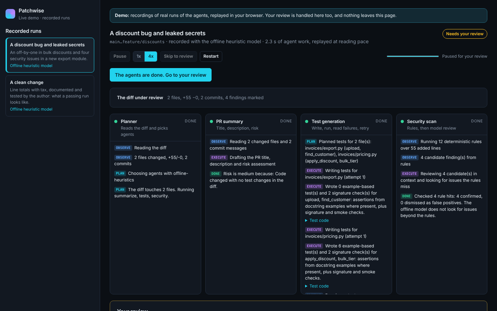
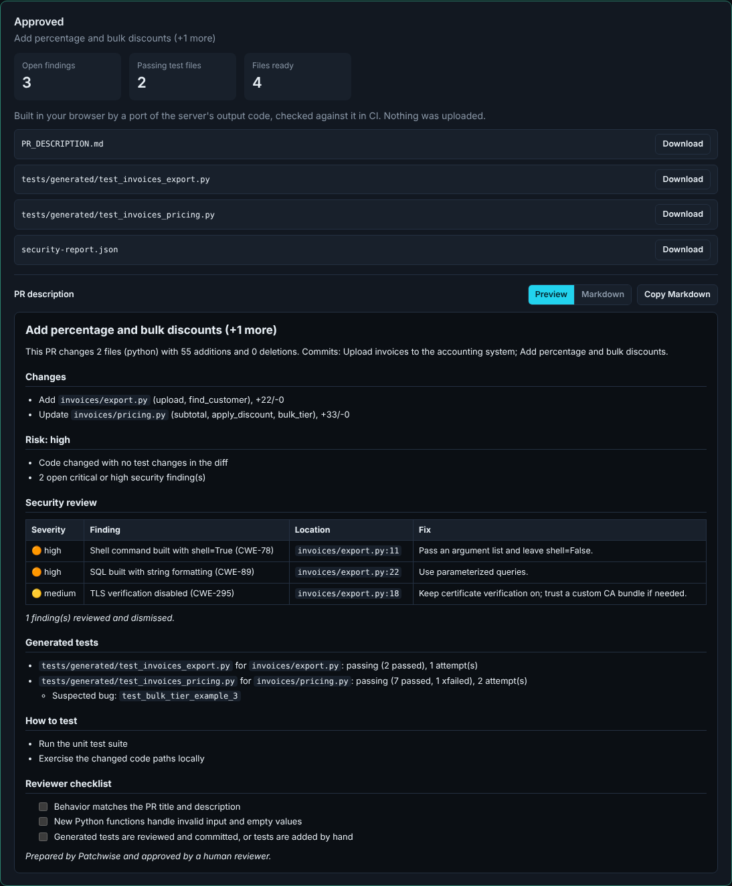

# Patchwise

Agentic PR prep with a human in the loop. (Formerly AI-Native SDLC Orchestrator; the repo, package and `sdlc-orchestrator` command keep that name.)

An agentic workflow that prepares pull requests. A planner agent reads a branch's diff and sends work to three specialist agents, which write the PR description, generate and run unit tests, and scan the change for security issues. Each agent works in a plan, observe, execute loop, streams its reasoning to a live dashboard over WebSocket, and then the whole run pauses until a human approves, edits or rejects it.

Built with **LangGraph**, **AWS Bedrock**, **FastAPI**, and **React + TypeScript**.

**Try it:** [gilbertanderson.com/ai-sdlc-orchestrator](https://gilbertanderson.com/ai-sdlc-orchestrator/) replays recorded runs of the real agents in your browser. Watch them work through a branch, then approve, edit or reject the PR yourself and download what they prepared. Nothing is installed and nothing leaves the page.



## How it works

```
observe_diff -> plan --+--> summarize ------------------------------+
                       +--> tests_plan -> tests_write -> tests_run -+--> human_review -> finalize
                       |                      ^             |       |     (interrupt)
                       |                      +--- retry ---+       |
                       +--> security_rules -> security_review ------+
```

| Agent | Plan | Observe | Execute |
|---|---|---|---|
| **Planner** | Decides which agents the diff needs and what each should focus on | Parses the diff, commit messages and changed symbols | Fans out to the chosen agents in parallel |
| **PR summary** | | Reads the diff and commits | Writes the title, description, risk level, testing notes and reviewer checklist |
| **Test generation** | Finds the top-level Python functions the diff touched | Runs the tests with pytest against a clean checkout of the PR head | Writes a test file; on failure, reads the pytest output and rewrites it, up to 3 attempts. If a failure points at a bug in the code rather than the test, it keeps the test as `xfail` and reports the suspected bug |
| **Security scan** | | Runs 12 deterministic rules (secrets, shell and SQL injection, unsafe deserialization, disabled TLS checks and more) over added lines | The model confirms or dismisses each hit in context and looks for issues the rules can't catch |

`human_review` is a deferred node, so it waits for every branch, including the test retry loop, and then calls LangGraph's `interrupt`. The reviewer can edit the title, dismiss false positives, keep or drop the generated tests, optionally write them into the repo, and add a note. Nothing is written until they approve. Open critical or high findings raise the PR's risk to high.

On approval the run writes `PR_DESCRIPTION.md`, the passing test files and `security-report.json` to `runs/<run-id>/`.

## Quick start

```bash
# backend
cd backend
python -m venv .venv && source .venv/bin/activate
pip install -e ".[dev]"

# dashboard
cd ../frontend && npm install && npm run build

# serve the API and the built dashboard on http://127.0.0.1:8000
cd ../backend && sdlc-orchestrator serve
```

Click **Run the demo**. It creates a small invoicing repo whose feature branch has a real off-by-one bug (`bulk_tier(50)` returns 5 instead of the documented 10) and a file with a hardcoded API key, a `shell=True` call, string-built SQL and disabled TLS verification. You'll see the test agent fail, retry and flag the bug, and the security agent report the four issues. A second sample, `clean`, is a tidy change with tests by its author, which passes on the first try.

For frontend development, run `npm run dev` in `frontend/` while the backend is running; Vite proxies `/api` and `/ws` to port 8000.

### Command line

```bash
sdlc-orchestrator run --repo ~/code/my-service --base main --head my-branch   # review in the terminal
sdlc-orchestrator run --demo --yes --json                                     # sample repo, auto-approve
sdlc-orchestrator run --demo --scenario clean --yes                           # the clean sample
sdlc-orchestrator demo-repo ./sample                                          # create the sample repo
sdlc-orchestrator record --out-dir ../frontend/public/runs                    # record runs for the browser demo
```

## Browser demo

The demo at gilbertanderson.com runs without a server, because the server runs model-written tests and shouldn't be exposed to the internet. Instead it replays real runs:

1. `sdlc-orchestrator record` runs each sample through the real graph up to the human review, and saves every message the server would have sent over the WebSocket, with its timing, plus the diff and the agent's own summary (`frontend/public/runs/`).
2. The dashboard builds a second time with `npm run build:demo`. The only difference is where messages come from: a `ReplayTransport` plays a recording into the same reducer and components the live dashboard uses, at reading pace, with pause, 4x and skip.
3. When a visitor approves or rejects, `frontend/src/demo/outputs.ts` builds the PR description, test files and security report in the browser. It's a TypeScript port of `prepare_outputs`, and its tests compare it byte for byte with golden outputs that Python writes for the same recordings, so the two can't drift apart.



On every push to `main`, the Pages workflow re-records the offline runs from that commit's code, checks the port against them, runs the browser tests (desktop, phone and an axe accessibility scan) and deploys. Runs recorded with Bedrock (`LLM_PROVIDER=bedrock sdlc-orchestrator record --scenario invoicing ...`) are committed and deployed as they are. The demo has the two offline runs for now; a run recorded with Claude on Amazon Bedrock is coming.

```bash
cd frontend
npm run dev:demo          # the demo with hot reload, at /ai-sdlc-orchestrator/
npm run build:demo        # static build in dist-demo/
npm run e2e               # Playwright: the full visitor flow on desktop and phone
```

## Models

| `LLM_PROVIDER` | What runs |
|---|---|
| `offline` (default) | A deterministic heuristic model that answers every agent task without any credentials. It builds tests from docstring examples and signatures, confirms rule hits and dismisses obvious placeholders. It's what the tests and the demo use. |
| `bedrock` | Claude on AWS Bedrock through the Converse API (`langchain-aws`). Uses your normal AWS credentials. |

```bash
export LLM_PROVIDER=bedrock
export AWS_REGION=us-east-1
export BEDROCK_MODEL_ID=us.anthropic.claude-sonnet-4-5-20250929-v1:0   # any Bedrock chat model ID or inference profile
```

Other settings: `MAX_TEST_ATTEMPTS` (3), `MAX_TEST_FILES` (3), `TEST_TIMEOUT_S` (60), `RUNS_DIR` (`./runs`).

## API

| Method | Path | |
|---|---|---|
| `GET` | `/api/health` | Version and active model |
| `POST` | `/api/runs` | Start a run: `{"repo": "/path", "base": "main", "head": "HEAD"}`, `{"diff": "..."}` or `{"demo": true}` (add `"scenario": "clean"` for the clean sample) |
| `GET` | `/api/runs`, `/api/runs/{id}` | List runs, or get a run's events, review payload and report |
| `POST` | `/api/runs/{id}/review` | `{"decision": "approve" \| "reject", "title", "note", "dismissed": [ids], "include_tests", "apply_tests"}` |
| `WS` | `/ws/runs/{id}` | Sends a snapshot, then `event` and `status` messages. Send `{"type": "review", "review": {...}}` to resume |

## Security note

The test agent runs model-written code with your Python interpreter, in a temporary checkout with a timeout. The server binds to `127.0.0.1` by default; don't expose it on a network you don't trust.

## Tests

```bash
cd backend && pytest -q      # diff parsing, rules, offline model, full graph runs, recordings, HTTP and WebSocket API
cd frontend && npm test      # reducer, agent lanes, review panel, replay player, output parity with Python
cd frontend && npm run e2e   # the browser demo end to end, with an accessibility scan
```

## Project layout

```
backend/sdlc_orchestrator/
  graph.py           LangGraph workflow and agents
  llm.py             Bedrock and offline models
  prompts.py         Agent system prompts
  security_rules.py  Deterministic security rules
  testrunner.py      Clean checkouts and pytest runs
  diff.py            Diff parsing and git helpers
  report.py          PR description rendering
  server.py          FastAPI + WebSocket server
  cli.py             Command line
  demo.py            Sample repositories
  record.py          Recording runs for the browser demo
frontend/src/        React dashboard
frontend/src/demo/   Browser demo: replay player, output port, diff view, downloads
frontend/public/runs Recorded runs the demo replays
```

## Status

In active development, with a public browser demo of recorded runs. Next up: posting the description and findings straight to a GitHub pull request, test generation for TypeScript with Vitest, and persisting runs across server restarts.
